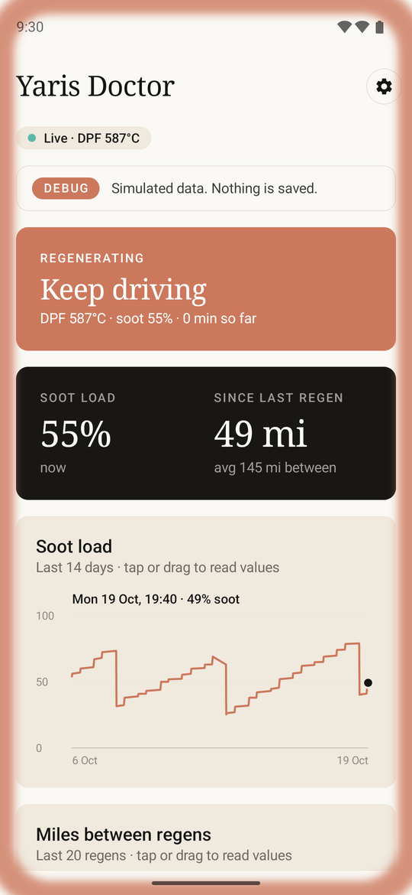
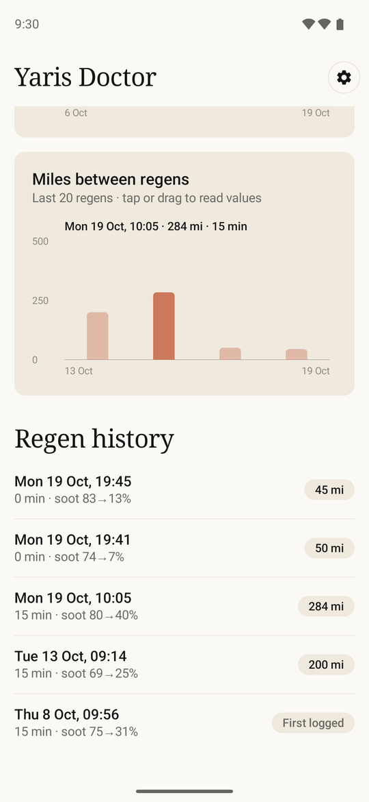
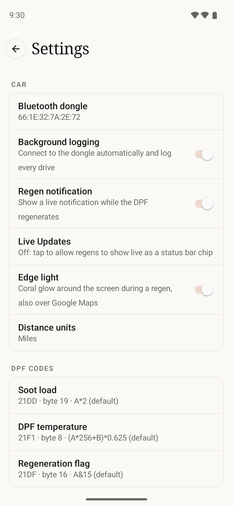
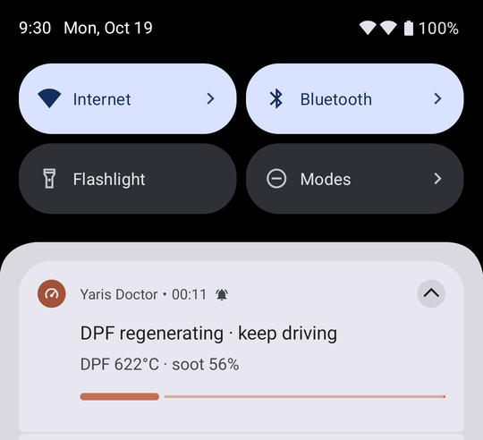

# Yaris Doctor

An Android app that sits silently in the background and watches the diesel particulate filter (DPF) on a Toyota Yaris diesel through a cheap ELM327 Bluetooth OBD-II dongle.

When the car starts and the dongle powers up, the app connects by itself and logs soot load, DPF temperature and regeneration state. When the car starts a DPF regeneration, a live notification appears so you know to keep driving; it disappears when the regen finishes. Every regen is saved with its duration and the miles driven since the previous one.

It replaces DPFViewer, an earlier ESP32 + TFT dashboard that read the same values.

<p align="center">
  
  
  
</p>
<p align="center">
  
</p>
<p align="center"><sub>Screenshots in Debug mode (simulated data) on an Android 16 emulator sized like a Galaxy S25.</sub></p>

## Install

Scan with your phone to add it to [Obtainium](https://github.com/ImranR98/Obtainium), which installs it and keeps it updated from this repo's releases:

<p align="center">
  <a href="https://apps.obtainium.imranr.dev/redirect?r=obtainium://add/https://github.com/alexscemo/yaris-doctor">
    
  </a>
</p>

On the phone itself, tap the QR code. Or, in Obtainium, choose **Add app** and paste `https://github.com/alexscemo/yaris-doctor`.

Without Obtainium, download the latest `yaris-doctor-vX.Y.Z.apk` from [Releases](https://github.com/alexscemo/yaris-doctor/releases) and open it.

Requires **Android 12 or newer**.

## Setup

1. **Pair the dongle** in Android's Bluetooth settings with the ignition on. The PIN is usually `1234` or `0000`.
2. **Open the app and allow everything it asks for:**
   - **Nearby devices (Bluetooth)**: needed to talk to the dongle.
   - **Location → "Allow all the time"**: GPS is how distance between regens is measured. Without it, logging still works but miles stay at 0.
   - **Notifications**: for the regen alert.
   - **Unrestricted battery use**: otherwise Android kills the background service.

3. **Pick your dongle:** tap the settings icon (top right) → **Bluetooth dongle**, and choose it from your paired devices.

From then on it starts at boot. There is nothing to open before a drive.

## What you get

- **Regen alert:** a high-priority, ongoing notification while the DPF regenerates. It shows a running timer, DPF temperature and soot load, updated every second. On Android 16 it is a Live Update with a burn-off progress bar: Samsung (One UI 8) shows it in the Now Bar, other phones as a status-bar chip. Older Android versions get the normal notification.
- **Edge light (optional):** a coral glow around the screen edges during a regen, drawn over other apps such as Google Maps so it is noticed at a glance. Turn it on in Settings → Car; it asks for "Display over other apps". Touches pass straight through.
- **Regen history:** for every regen it records the start time, how long it took, soot before and after, and the miles driven since the previous regen ended.
- **Full log:** soot, temperature and regen state every 5 s while driving (1 s during a regen), stored in a SQLite database on the phone.
- **App screen:** current soot and miles since the last regen, a 14-day soot chart, a miles-between-regens chart (tap or drag to read values), and the regen history.
- **Settings** (icon, top right): dongle, background logging on/off, regen notification on/off, miles or kilometres.
- **Debug mode** (Settings → Developer): a simulated dongle feeds random but plausible data, with 14 days of fake history and a regen every few minutes, so you can try the screen and the notification without the car. Nothing is saved to your real log. Debug mode turns itself off when the phone restarts or Android closes the app.

A small, low-priority notification ("Waiting for dongle" / "Logging") is always present. Android requires one for any app that runs in the background continuously.

## Home hub (optional)

Run **[Yaris Doctor Hub](https://github.com/alexscemo/yaris-doctor-hub)** on a home server (one Docker container) to
keep every phone's log in one place. If two people drive the car, their trips add up, and you get a dashboard in the
browser. In the app, **Settings → Home hub**: set the **Hub address** (e.g. `192.168.1.50`) and your **Home Wi-Fi name**.
Both are empty by default, and nothing leaves the phone until both are set. After that, new data uploads by itself
about a minute after you get home; **Sync now** forces it. Debug-mode data is never uploaded.

Sync works both ways. While at home, the app also downloads what the other phones logged, so your own screen shows the
whole car: the latest soot reading, regens and the distance since the last one, whoever was driving. This needs a hub
from October 2026 or later (it adds `/api/export`).

## How it works

- **Finding the car.** An ELM327 dongle never connects to the phone on its own, so the app checks about once a minute and tries to connect. It uses an alarm, so this still happens while the phone is asleep. If the dongle answers but the engine ECU doesn't (ignition off, dongle still powered), it disconnects within seconds so a parked car doesn't drain the phone.
- **Reading the ECU.** The app sets the dongle to talk to the engine ECU (`AT SH 7E0`, `AT CRA 7E8`, CAN 11-bit 500 kbps). It then polls three Toyota mode-21 PIDs:

  | PID | Value | Byte (from 0, incl. the echoed `61 xx`) | Formula |
  |---|---|---|---|
  | `21 DD` | Soot load (%) | 19 | `A*2` |
  | `21 F1` | DPF temperature (°C) | 8 | `(A*256+B)*0.625` |
  | `21 DF` | Regen active | 16 | `A&15` (regen when it gives 1) |

  These were found by trial and error on one car (see DPFViewer). Other Yaris engines or model years may differ. In **Settings → DPF codes** you can set each reading's PID, byte position and formula (leave a field blank to go back to the default). Formulas work like Torque's: `A` is the byte at the position, `B` the next, then `C`, `D`, with numbers, `+ - * /`, `&` (bitwise AND) and brackets. Results are rounded down.
- **Distance.** The car's odometer PID isn't known, so distance comes from the phone's GPS, counted only while the dongle is connected. Fixes that are inaccurate or stationary are ignored to avoid GPS drift.
- **Engine off mid-regen.** The regen is closed at the moment the connection drops, and the notification is cleared.

## Limitations

- When the phone has been asleep a while, Android can delay the background check by a few minutes, so the first minutes of a drive may not be logged.
- A regen that is interrupted by switching off and then finished on the next drive is stored as two regens, the second with a tiny "miles since last".
- GPS distance is an estimate and misses any driving done without the phone.
- Some ELM327 clones refuse Android's standard Bluetooth serial connection. If the app never connects, the dongle may be the cause.
- There is no data export yet. The database is included in Android's normal app backup.

## Building

The project uses only the Android framework (no AndroidX or third-party libraries) and has a single module.

- **Android Studio:** open the folder and run. It generates the Gradle wrapper on first sync.
- **Command line:** with JDK 17, the Android SDK and Gradle 8.11.1:
  ```sh
  gradle test assembleDebug   # APK in app/build/outputs/apk/debug/
  ```

The unit tests cover the ELM327 reply parser and the PID decoders, and need no device.

## Releases

CI ([`build.yml`](.github/workflows/build.yml)) builds and tests every push to `main`. Pushing a version tag publishes a signed APK as a GitHub Release, which Obtainium picks up:

```sh
git tag v0.2.0 && git push origin v0.2.0
```

The signing key lives in the repo secrets `KEYSTORE_BASE64` and `KEYSTORE_PASSWORD`. It must never change: an APK signed with a different key can't update the installed app, and reinstalling deletes the logged history.

## License

[MIT](LICENSE)
